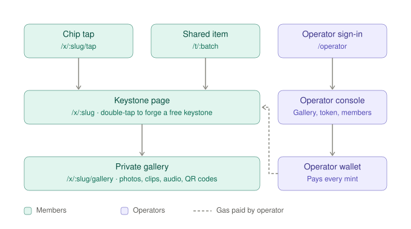

# keystone-manager

Keystones: NFC-unlocked passes to private photo galleries, issued by operators and claimed by tapping a physical item.

A member taps their item, claims a keystone (minted gasless: the operator wallet pays), and lands in a private photo
gallery. Operators run everything from `/operator`: keystones, contracts, galleries, chips, members and the look of
each step.



Page-by-page flows and diagrams: [docs/USER_FLOWS.md](docs/USER_FLOWS.md).

## How it works

- **Operators** (e.g. ay.llu, GOAT community, Sahar Camp) issue **keystones**: one universal token, optionally
  with dates and a location (a gathering or season); without dates it's ongoing.
- **One link per keystone:** `/x/<slug>` (renaming a keystone moves it; old links redirect). A chip tap (`/x/<slug>/tap`) opens the claim screen
  directly; once the chip is verified the member slides one button to secure it (signing in with Privy
  if needed, then forging) and lands in `/x/<slug>/gallery`. A physical tap is the only way in.
- **Item batches:** one physical item can unlock several keystones from the same operator via `/t/<batch>`.
- **Gallery photos** are Pinata private files, served as short-lived signed links only to current holders.
- **On chain**, each keystone is a `KeystonePass` ERC-721 on Base: operator-only mint, on-chain metadata (image,
  description, attributes), optional freeze, and an operator toggle for non-transferable (soulbound, ERC-5192) keystones.
- **Chips:** plain NTAG chips use HMAC-signed links; NTAG 424 DNA chips use SUN messages (AES-CMAC, per-tap
  counter, replay-protected).

## Routes

| Path | Who | What |
| --- | --- | --- |
| `/` | Members | Home: your keystones by time, and their operators (live on-chain holdings) |
| `/operators`, `/o/<operator>` | Members | Operators that issued you keystones, one operator's keystones |
| `/x/<slug>` · `/tap` · `/gallery` | Members | Claim page (also opened by a chip tap), private gallery |
| `/t/<batch>` | Members | Physical item that unlocks several keystones |
| `/operator` | Operators | Console (allowlisted sign-in only) |

Member APIs live under `/api/{tap,items,k,me}`; operator APIs under `/api/admin/*` and all require
an allowlisted operator.

## Run locally

```bash
npm install
npm run dev
```

Open http://localhost:3000. Use port 3000: it's the origin allowed in the Privy dashboard, so sign-in fails on
other ports.

### Environment (`.env.local`)

| Variable | Purpose |
| --- | --- |
| `NEXT_PUBLIC_PRIVY_APP_ID`, `PRIVY_APP_SECRET` | Privy auth (client + server token verification) |
| `NEXT_PUBLIC_ENABLE_EMAIL_LOGIN` | `true` to offer email login alongside SMS |
| `OPERATOR_PHONES`, `OPERATOR_EMAILS`, `OPERATOR_WALLETS` | Comma-separated operator allowlist for `/operator` |
| `PRIVATE_KEY` | Operator wallet: deploys keystone contracts and pays every mint |
| `NEXT_PUBLIC_GATE_CHAIN_ID` | `84532` Base Sepolia (default) or `8453` Base |
| `PINATA_JWT`, `NEXT_PUBLIC_PINATA_GATEWAY` | Private gallery files and public token art |
| `TAP_SECRET` | HMAC key for static chip links |
| `NTAG_MASTER_KEY` | Master key for NTAG 424 DNA chips (per-keystone keys are derived) |
| `APP_URL` | Public base URL used in chip links |

Data (operators, keystones, members, chip counters) is kept in `data/store.json`. It's a single-server JSON
store; swap `lib/store.ts` for a database before deploying to serverless.

## Scripts

| Command | What |
| --- | --- |
| `npx tsx scripts/chip-url.ts <slug> <chipId>` | Print a signed chip link to write onto an NFC tag |
| `npx tsx scripts/ntag424-url.ts <slug>` | Simulate an NTAG 424 DNA tap (test minting without hardware) |
| `npx tsx scripts/verify-key.ts` | Check `PRIVATE_KEY` maps to the expected address |
| `npm run compile:pass` | Compile `contracts/KeystonePass.sol` into `lib/keystone-pass.json` |
| `python3 scripts/generate-brand-assets.py [operator\|slug…]` | Rebuild keystone brand media in `brand-assets/` from each keystone's saved details |
| `npx tsx scripts/apply-brand-assets.ts [operator\|slug…]` | Pin that media and apply it to the keystones |

## Project layout

```
app/            pages (member + /operator) and API routes
components/nfc  member UI       components/admin  operator console
lib/            store, auth, chain, tap/NTAG 424, Pinata, theme
contracts/      KeystonePass.sol
docs/           user flows, diagrams, NFC hardware notes
brand-assets/   generated operator media (see its README)
```

## Stack

Next.js 15 (App Router) · React 19 · Tailwind v4 · TypeScript · Privy · viem on Base · Hardhat + OpenZeppelin ·
Pinata.

More: [NFC hardware notes](docs/NFC_INSIGHTS.md) · [brand assets](brand-assets/README.md).
