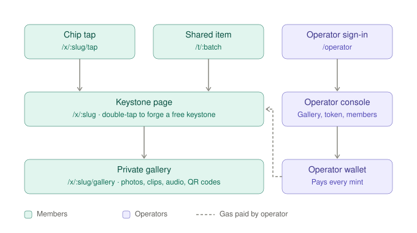
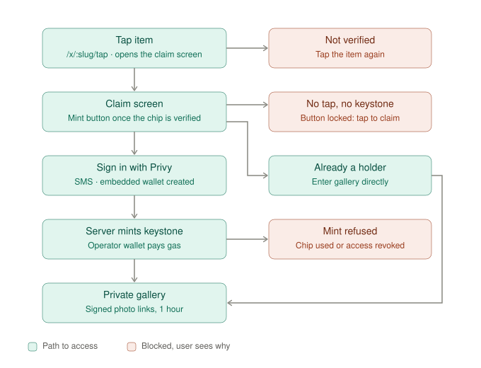
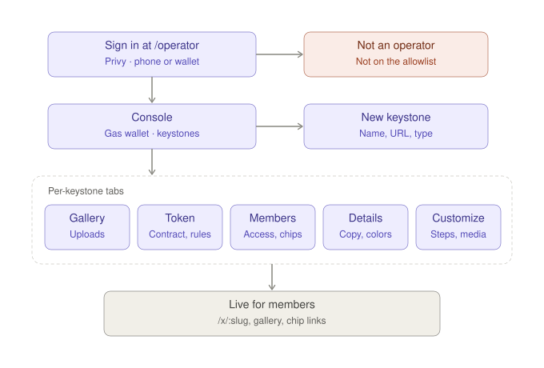
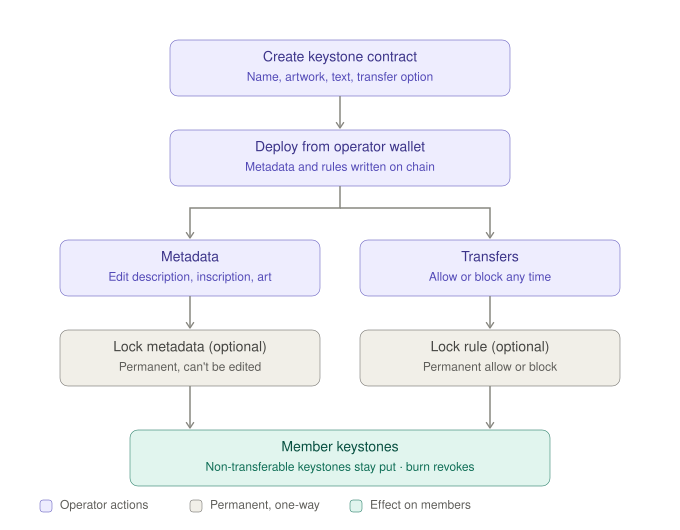

# User & operator flows

How each page of the keystone app behaves and hands off to the next. A **keystone** is the one token operators
issue: an NFC-linked pass that unlocks a private gallery, optionally with dates and a location.
Diagrams live in [`docs/flows/`](flows/) as standalone SVGs (light and dark mode).

## 1. Overview

Every keystone has one link, `/x/<slug>`. A **chip tap** (`/x/<slug>/tap`, or `/t/<batch>` for an item that
unlocks several keystones) opens a claim session, which leads to the keystone page and then the private
gallery (`/x/<slug>/gallery`). A physical tap is the only way in. The member home at `/` lists the keystones you hold. **Operators** sign in at `/operator`. Every mint is
signed and paid for by the operator wallet (`PRIVATE_KEY`), so members never need ETH.

**Renaming a keystone moves its link.** Saving a new name in Details changes the slug to match
(`ay.llu Live CDMX 2027` → `/x/ay-llu-live-cdmx-2027`; a taken slug gets `-2`). Old links and chips
keep working. Old paths redirect to the new one (chip query included), and chips stay bound to the keystone's
original slug, so they never need reprogramming. Old slugs stay reserved and can't be given to another keystone.

## 2. Member claim (chip tap)

Members see branded terms: **Align keystone** (chip verification), **Secure keystone** (claim), **Forge keystone**
(mint) and **Enter the vault** (open the gallery). The console and the code keep the standard terms.

| Page | What happens | Next |
|---|---|---|
| `/x/:slug/tap?c=&s=` | Opens the claim screen immediately (the address becomes `/x/:slug`). In the background, `POST /api/tap` checks the chip signature and sets a 24h claim cookie; a small "Aligning keystone…" alert with a spinner sits just above the artwork, left-aligned (minting shows "Forging your keystone…" the same way) | Aligned → the **Forge keystone** button appears; failed → an error with "tap again" |
| `/x/:slug` | The claim screen: the operator's **background** media full-screen, the **keystone artwork** over it and the contract **description** under it. Once the keystone is aligned there is **no button**: members **double-tap the artwork** to forge (like confirming Apple Pay), guided by a quiet "Double-tap the keystone to forge" hint ("…to secure it" when signed out). Forging shows only a small spinner, forged only a check; no badges or alerts. Holders returning see **Enter the vault** and Owned; otherwise **Tap your item to secure** (no claim session) or **Access revoked** | A double-tap while signed out opens Privy SMS login and resumes the forge automatically. A screen-reader button does the same for assistive tech |
| `POST /api/k/:slug/mint` | Requires claim session + Privy token. Enforces one wallet per chip, blocks revoked members, idempotent for holders | Success → the vault (gallery) after a short "Forged" moment |
| `/x/:slug/gallery` | `GET /api/k/:slug/access` confirms access and returns photos as 1-hour signed Pinata links | Non-holders / revoked / signed-out are redirected to `/x/:slug` |

### Member area: `/`, `/operators`, `/o/<operator>`

**After a tap**, a member lands on the keystone's gated content: holders go straight to the gallery once the tap is verified;
new members claim and mint once, then land there. Under the photos, two lists appear **only when they have
something to show** (otherwise the member just stays in the gallery):

| List | Shows when | Contents |
|---|---|---|
| **More from {operator}** | The member holds other usable keystones from the same operator | Those keystones with dates and location when set, with **See all →** to `/o/<operator>` |
| **Your other operators** | The member holds usable keystones from other operators | One card per other operator, with **See all →** to `/operators` |

Signed-in members switch between two tabs. Every keystone is checked against **current on-chain holdings**
of every wallet on the account, using the same rules as the gallery. Lists are ordered by time: **Upcoming &
live** (soonest first, Live tag), **Ongoing** (no dates), then **Past** (newest first).

| Page | Shows |
|---|---|
| **Home** `/` | Every keystone you hold, by time, each with dates, location and operator; then up to 3 operator cards |
| **Operators** `/operators` | One card per operator that issued you a keystone: name, how many you hold, their names, the next dated one. Operators you no longer hold any from appear under **Former** |
| **Operator page** `/o/<operator>` | Every keystone from that operator, by time |

Keystone statuses (on every row):

| Status | When | Shows |
|---|---|---|
| Active | Claimed and still held | **Open →** gallery |
| Received | Held but never claimed here (sent from another wallet; impossible while transfers are blocked) | **Open →** with a *Received* tag |
| No longer held | Claimed, but the keystone moved to another wallet | Dimmed, links to the claim page |
| Revoked | Revoked by an operator | Dimmed, no link |
| Unknown | The chain couldn't be reached | **Open →**, since the gallery re-checks |

### Physical items that unlock several keystones: `/t/<batch>`

An operator can group physical items (wristbands, pins, tickets) into an **item batch** that unlocks several of
**that operator's** keystones. Each item still has its own unique chip link:

- static chips: `/t/<batch>?c=<item id>&s=<signature>`
- NTAG 424 DNA: `/t/<batch>?picc_data=…&cmac=…` (each chip's UID is its item id)

| Step | Behaviour |
|---|---|
| Tap | `POST /api/items/tap` verifies the item once and opens a claim session for every keystone in the batch |
| One keystone in the batch | Behaves exactly like a keystone chip: claim → gallery, or straight to the gallery for holders |
| Several keystones | *This item unlocks N keystones* — one button claims them all (sign in first if needed; gas covered). Already-held keystones show *Yours*. When everything is held, the member lands in the **first (★) token's gallery**, whose *More from {operator}* list shows the rest |
| Adding a keystone later | Items already handed out unlock it on their next tap — no reprogramming |
| One wallet per item | Claims record `item:<batch>:<item id>`, so each item claims each keystone once; a copied link can't claim again |

Rules: a batch only accepts its own operator's keystones (checked when saving and again on every tap); a link signed
for one batch, or a per-keystone chip link, can't open another batch; NTAG 424 batches have their own keys
(scope `item-batch/<id>`) and reject replays. Per-keystone chip links (`/x/<slug>/tap`) keep working.

## Operators & keystones

Every keystone belongs to an **operator**, a creator, community or brand such as **ay.llu**,
**GOAT community** or **Sahar Camp**. There's one token type, the keystone. Each can optionally have a start
date (and end date for multi-day ones) and a location; with no dates it's **ongoing**. Dates only decide how
keystones are ordered and labeled (*Upcoming*, *Live*, *Past*); every keystone uses the same `KeystonePass`
contract, NFC chip flow, gallery and Customize options.

The console is organized by operator: pick one from the **operator dropdown** (which also has **+ New operator**), see its keystones as a **list** or as artwork **icons**, newest first (by creation date), and open one to manage it. Sign-in is a
single operator allowlist for now (`OPERATOR_PHONES` / `OPERATOR_EMAILS` / `OPERATOR_WALLETS`); per-operator
logins can be added later.

## 3. Operator console

| Area | What operators do |
|---|---|
| Sign-in | Privy login checked against `OPERATOR_PHONES` / `OPERATOR_EMAILS` / `OPERATOR_WALLETS`. Others see "Not an operator" |
| Operators | Row of operators (ay.llu, GOAT community, Sahar Camp, …) with keystone counts; **+ New operator** |
| Keystones | For the selected operator: its keystones under **Upcoming & live**, **Ongoing** and **Past**, and **+ New keystone** (name, link, optional dates and location) |
| Gas wallet | A dropdown in the top bar next to "Operator console": the button shows the balance (amber "Low" when it runs short, red if unreachable); it opens the chain, estimated mints remaining, copy address to fund, and the explorer link |
| Gallery tab | The vault's **banner** (wide image or short loop, saves right away) and its items: **photos** (≤ 25 MB), **short clips** (MP4/WebM/MOV, ≤ 60 s and 100 MB), **audio notes** (MP3/M4A/WAV/OGG/WebM, ≤ 10 min) and **QR codes** (a link + label, drawn in the browser). Files go to Pinata **private** IPFS; QR links are stored in the app and, like the files, only sent to holders. Items show at their real shape in the same masonry grid as the vault; drag a tile onto another to reorder (or use the ← → buttons); remove (also deletes the file at Pinata). A live phone preview on the right shows the vault as members see it; tap an item to open the viewer |
| Items tab | The keystone's physical items: chip type (static or NTAG 424 DNA), chip-link generator with CSV export or the NTAG 424 programming sheet, and multi-keystone item batches that include it (new batches start with it) |
| Details tab | Name, symbol and description (what the contract commits), **traits** (key–value attributes for the contract: optional **Location**, **Start date** and **End date** rows added with their own buttons, then your own Text / Number traits); **keystone artwork** (an image, or a looping MP4/WebM up to 15 s) shown exactly as uploaded; and the **contract**: **Create keystone contract** with a tokenURI preview, then after deploy its status, reference links (BaseScan: contract, token tracker, deployment tx, keystone #1; OpenSea on Base mainnet, since OpenSea no longer lists testnets), on-chain metadata (write / lock) and transfer controls (see [Keystone contract](#4-keystone-contract)) |
| Members tab | Members table (chip, claim date, tx), revoke / restore / release chip |
| Customize tab | The claim screen's look, with a live phone preview of every state, labeled i–iv (i aligning, ii ready, iii forging, iv forged; double-tap the artwork in the preview to play the forge). **Background**: full-screen media (PNG, JPG, WebP, GIF, AVIF or MP4/WebM loop up to 20 MB and 15 s, pinned to public IPFS), a color behind it, and how much the media is darkened. **Keystone artwork**: size (50–100%), position (top / center / bottom), corners, border width and color, shadow. **Description text**: size (12–20 px), color, alignment. **Alerts & hints**: your own wording for the aligning alert, the not-aligned message and the double-tap hints, plus their text and background colors. Everything is optional; **Reset styling to standard** clears it. The server clamps values to these ranges |

## 4. Keystone contract

Each keystone is a `KeystonePass` ([contracts/KeystonePass.sol](../contracts/KeystonePass.sol)),
an ERC-721 deployed from the console and owned by the operator wallet. Only the operator wallet can mint,
and it pays the gas, so members claim for free and nobody can mint around the tap flow.

**What's committed on chain.** The contract builds its own `tokenURI` / `contractURI` JSON, so wallets and
marketplaces read the keystone straight from the chain. Every field comes from the keystone's **Details**
(there are no separate contract text fields): edit and save Details, then deploy.

Each `tokenURI(id)` returns OpenSea-standard JSON:

| Key | Comes from |
|---|---|
| `name` | Details name + ` #<token number>` (ERC-721 name, fixed at deploy) |
| `description` | Details description (up to 500 characters) |
| `image` | `ipfs://<CID>` of the keystone artwork (for video artwork, its first frame), a content address that pins the exact image |
| `external_url` | The keystone's page, `<APP_URL>/x/<slug>` |
| `background_color` | The keystone's first color, six hex digits without `#` |
| `animation_url` | `ipfs://<CID>` of the looping video when the keystone artwork is a video (omitted for image artwork) |
| `attributes` | **Location** and **Start Date** / **End Date** when set (`display_type: "date"`, unix seconds), then the operator's own **Traits** from Details (text, or numbers with `display_type: "number"`; up to 20). Empty `[]` when there are none. Transferability isn't a trait: wallets read it from the contract (`transferable()`, ERC-5192 `locked()`) |

`contractURI()` returns the collection-level `name`, `description`, `image` and `external_link`. The symbol is the
ERC-721 symbol from Details, fixed at deploy. Empty optional keys are left out.

**Deploy options** (Details tab → Create keystone contract), paid by the operator wallet:

| Option | Effect |
|---|---|
| Non-transferable keystones (on by default) | Blocks wallet-to-wallet moves for **every** keystone |
| Lock metadata at deploy | Description, artwork, links, colors, animation and attributes can never change |

**After deploy** (Details tab → Contract panel, shown only once a contract exists). Each change is a transaction
paid by the operator wallet, with an explorer link:

| Control | Effect | Reversible? |
|---|---|---|
| Status | Address (copy), standard, symbol, minted count, contract and deployment-tx explorer links | n/a |
| Write details to chain | Appears when the metadata built from the saved Details (description, artwork, link, colors, animation, attributes) differs from the chain; writes all of it. Marketplaces are told to refresh (ERC-4906) | Until metadata is locked |
| Lock forever | All on-chain metadata can never change | No |
| Make non-transferable / Allow transfers | Blocks or allows wallet-to-wallet moves for **every** keystone, existing and future | Until the rule is locked |
| Lock rule | Fixes the current transfer setting forever | No |

**While transfers are blocked:**

- **Refused:** holder transfers, and moves by approved marketplaces or wallet apps.
- **Still works:** minting new keystones, operator burns (revoke), claiming, and gallery access.
- **Lost wallets:** a member who changes accounts can't move their keystone. Burn the old one if needed, release
  their chip (Members tab → release), and they claim again with the new account.
- **Marketplace signals (ERC-5192):** `Locked` is emitted per keystone at mint while soulbound. Switching the rule
  emits `Unlocked` (transfers on) or `Locked` (transfers off) for every existing keystone, skipping burned ones, plus
  one `TransferabilitySet`; re-sending the current rule does nothing. `locked(tokenId)` and `transferable()` always
  return the live rule. The switch costs more gas as the collection grows (about 3,300 gas per keystone: roughly
  83k gas at 10 keystones, 382k at 100), which stays small on Base.

## Access: two front doors

| | Members | Operators |
|---|---|---|
| Entry | `/` (member home), `/x/<slug>`, chip taps | `/operator` |
| Sign-in | Privy (SMS, wallet, optional email) | Privy, **and** on the server allowlist (`OPERATOR_PHONES` / `OPERATOR_WALLETS`) |
| API | `/api/k/*`, `/api/me/*`, `/api/tap`, `/api/items` | `/api/admin/*` |

The operator page shell is public, but it holds no data or secrets. Everything it shows or changes goes
through `/api/admin/*`, and every one of those routes verifies the Privy session **and** the allowlist
on the server (`requireOperator`). A signed-in member who opens `/operator` sees "Not an operator", and
their direct API calls get `403`.

For an extra layer, serve the console on a separate hostname, or put `/operator` behind your host's
access controls (e.g. Cloudflare Access or Vercel password protection). The server checks above apply
either way.

## Required configuration

| Variable | Used for |
|---|---|
| `PRIVATE_KEY` | Operator wallet that signs and pays for every mint and deploy |
| `PRIVY_APP_SECRET` | Server-side verification of Privy sessions |
| `OPERATOR_PHONES` / `OPERATOR_EMAILS` / `OPERATOR_WALLETS` | Who can open `/operator` |
| `TAP_SECRET` | Signing chip URLs and claim cookies |
| `PINATA_JWT` | Uploads (needs `org:files:write`) |
| `NEXT_PUBLIC_PINATA_GATEWAY` | Dedicated gateway (`yourname.mypinata.cloud`), required for private files |
| `APP_URL` | Optional. Public origin for chip links and `external_url` behind a proxy |
